# AD9226 → UDP na Digilent Arty A7

Projekt pobiera równoległe 12-bitowe dane AD9226, wybiera co `DECIMATION`-tą
próbkę i wysyła bloki przez wbudowany Ethernet 100 Mb/s. Adresy IP, MAC i port
UDP są stałe. FPGA nie realizuje ARP, DHCP ani odbioru poleceń.

Przyjęta płytka to **Arty / Arty A7-35T**, z PHY **DP83848J i interfejsem MII**.
Arty A7-100T wymaga zmiany argumentu układu w poleceniu Vivado; nie wykonano
builda dla 100T. Arty S7 ma inne wyposażenie i nie jest celem tego projektu.
Pinout zewnętrznego ADC jest propozycją do późniejszego dopasowania.

## Tor danych i ustawienia

```mermaid
flowchart LR
    ADC[AD9226: 12 bit + OTR] --> CAP[Rejestr wejściowy: 50 MHz]
    CAP --> FMT[Wybór co 16. próbki + nagłówek bloku]
    FMT --> FIFO[Taxi: FIFO całych bloków]
    FIFO --> UDP[WZab: Ethernet / IPv4 / UDP]
    UDP --> TX[Taxi: FIFO całych ramek]
    TX --> MAC[Taxi: MAC MII + CRC32]
    MAC --> PHY[DP83848J: 100 Mb/s full duplex]
    PHY --> PC[Python: odbiornik UDP]
```



| Ustawienie | Wartość domyślna |
| --- | --- |
| Zegar ADC, wystawiany przez FPGA | 50 MHz |
| Wybór próbek | co 16. próbka, bez filtru antyaliasingowego |
| Próbki wysyłane | 3,125 MS/s |
| Próbki w pakiecie | 512 |
| Payload UDP | 1042 bajty: 18 bajtów nagłówka + 1024 bajty próbek |
| FPGA IP / MAC | `192.168.10.2` / `02:00:00:00:00:01` |
| Odbiorca IP / MAC | `192.168.10.1` / `ff:ff:ff:ff:ff:ff` |
| Port docelowy / źródłowy UDP | 5000 / 0 |
| UDP checksum | 0, dopuszczalne w IPv4; Ethernet ma CRC32/FCS |

Broadcastowy MAC pozwala zacząć bez znajomości MAC komputera. IP odbiorcy
pozostaje stałe. Najpierw użyj bezpośredniego kabla Arty–PC; później ustaw
`DEST_MAC` na MAC konkretnej karty sieciowej. Nie jest potrzebna tablica ARP
w FPGA. Ping do FPGA nie odpowie.

Przy domyślnych parametrach obciążenie łącza wynosi około 54,1 Mb/s,
uwzględniając preambułę, FCS i przerwę między ramkami. Ethernet tej płytki nie
pomieści wszystkich próbek 50/65 MS/s. FIFO przy przeciążeniu odrzuca **całe
bloki**, a numer bloku pozwala wykryć luki. UDP również nie gwarantuje dostarczenia.

Zmień adresy i parametry w [config.tcl](config.tcl). `DECIMATION` ma zakres
8…65535, a `SAMPLES_PER_PACKET` musi być parzyste, w zakresie 2…720. Małe
pakiety i mały podział mogą przekroczyć przepustowość 100 Mb/s. Użyte FIFO są
ramkowe: blok/ramka muszą mieścić się w ich pojemności.

## Budowanie w Windows / PowerShell

Wymagane: Python 3.10+, Git, **GHDL z wyjściem syntezy Verilog** i Vivado.
Do symulacji dodatkowo Verilator z `--binary --timing` oraz współczesny kompilator
C++20. Skrypty przykładu korzystają ze standardowej biblioteki Pythona.

Polecenia przygotowania wykonaj z katalogu głównego bazy:

```powershell
.\.venv\Scripts\python.exe -B -X utf8 examples/ad9226-udp/scripts/prepare.py
.\.venv\Scripts\python.exe -B -X utf8 examples/ad9226-udp/scripts/simulate.py
Set-Location examples/ad9226-udp
& D:/ProgramFiles/Xilinx/Vivado/2024.2/bin/vivado.bat -mode batch -source scripts/build.tcl -tclargs xc7a35ticsg324-1L bitstream
```

Jeżeli Vivado jest w `PATH`, użyj `vivado -mode batch ...`. Dla Arty A7-100T
zastąp układ przez `xc7a100tcsg324-1`. Argument `synth` wykonuje samą syntezę.
Bitstream trafia do `build/vivado/arty_ad9226_udp.bit`; skrypt przerywa przed jego
wygenerowaniem, jeśli wykryje ujemny slack setup/hold. Raporty są w `build/vivado`.

`prepare.py` pobiera przypięte zależności do katalogu tymczasowego
`gateware-ad9226-deps`, **poza bazą**. Możesz podać trwały katalog przez
`--deps-dir C:/fpga-deps/ad9226`. Rewizje są w [dependencies.json](dependencies.json).
Istniejący checkout z inną rewizją lub zmodyfikowanym kodem jest zachowywany,
a skrypt zgłasza błąd. W takim przypadku wybierz inny katalog zależności.

WZab VHDL jest poprawiany w `build/` i przekształcany przez GHDL do Veriloga,
więc Vivado nie musi mieszać języków na granicy interfejsów SystemVerilog.
Manifest zapisuje rewizje, licencje plików oraz SHA-256 źródeł i wyników konwersji.
Kod zależności nie jest kopiowany do repozytorium.

## Połączenie i pierwszy odbiór

1. Dopasuj pinout ADC w [constraints/arty_a7.xdc](constraints/arty_a7.xdc).
   Wejścia są ustawione na `LVCMOS33`: dopasuj poziomy wyjść konkretnego modułu
   ADC i połącz masy. AD9226 wymaga również swojego toru analogowego,
   zasilania i napięcia odniesienia.
2. Zbuduj bitstream dla układu na swojej płytce i wgraj go przez Vivado Hardware
   Manager. Ten projekt nie programuje płytki automatycznie.
3. Połącz Ethernet Arty z kartą PC; ustaw na tej karcie `192.168.10.1/24`.
   Zezwól odbiornikowi na UDP 5000 w zaporze systemowej.
4. Ustaw **SW0 = 1**. FPGA wysyła rampę testową zamiast danych ADC.
5. Uruchom z katalogu głównego bazy:

```powershell
.\.venv\Scripts\python.exe -B -X utf8 examples/ad9226-udp/host/receive.py --packets 1000
```

Do krótkiego zapisu próbek:

```powershell
.\.venv\Scripts\python.exe -B -X utf8 examples/ad9226-udp/host/receive.py --packets 100 --output samples.csv
```

CSV przy 3,125 MS/s może spowolnić odbiór. Odbiornik bez `--output` sprawdza
format i zlicza odebrane oraz brakujące bloki. Domyślnie zachowuje surowy kod
12-bitowy; opcje `--format twos-complement` i `--format offset-binary` służą do
interpretacji zgodnej z faktycznym ustawieniem kodowania ADC.

Po sprawdzeniu rampy ustaw **SW0 = 0**, aby odbierać ADC. **BTN0** resetuje
zegar, PHY i tor danych. LED0 oznacza zablokowanie MMCM, LED1 link 100/full po
autonegocjacji, LED2 przepełnienie bufora próbek od ostatniego resetu, a LED3
aktywność transmisji. Utrata linku resetuje buforowanie i numerację bloków.
PHY ogłasza tylko 100BASE-TX full duplex; link 10 Mb/s lub half duplex nie
uruchamia akwizycji.

## Proponowany pinout ADC

Numer na złączu oznacza fizyczny pin Pmod. Piny 5/11 to GND, 6/12 to zasilanie;
nie występują w poniższej tabeli sygnałów.

| Sygnał | Pmod | Pin FPGA |
| --- | --- | --- |
| D0 | JA1 | G13 |
| D1 | JA2 | B11 |
| D2 | JA3 | A11 |
| D3 | JA4 | D12 |
| D4 | JA7 | D13 |
| D5 | JA8 | B18 |
| D6 | JA9 | A18 |
| D7 | JA10 | K16 |
| D8 | JB1 | E15 |
| D9 | JB2 | E16 |
| D10 | JB3 | D15 |
| D11 | JB4 | C15 |
| OTR | JB7 | J17 |
| CLK → ADC | JB8 | J18 |

AD9226 aktualizuje wyjścia po zboczu narastającym zegara. Rejestr wejściowy
FPGA przejmuje poprzednie słowo przy kolejnym zboczu narastającym, po 20 ns.
XDC zakłada opóźnienie AD9226 3,5…7 ns oraz 0,5…1,5 ns łącznie na trasę
zegara do ADC i danych z powrotem. To **założenia dla proponowanego połączenia**:
po ustaleniu płytki ADC i okablowania trzeba uaktualnić budżet i sprawdzić timing.
Pierwsze 10 cykli po zwolnieniu resetu toru danych jest pomijane.

## Format datagramu

Wszystkie pola wielobajtowe są big endian. Offset jest liczony od początku
payloadu UDP, po jego ośmiobajtowym nagłówku sieciowym.

| Offset | Rozmiar | Pole |
| --- | --- | --- |
| 0 | 2 | numer wysłanego pakietu WZab, modulo 65536 |
| 2 | 4 | ASCII `AD26` |
| 6 | 4 | numer wytworzonego bloku ADC, modulo 2³²; obejmuje bloki odrzucone |
| 10 | 4 | indeks pierwszej próbki w domenie akwizycji, modulo 2³² |
| 14 | 2 | `DECIMATION` |
| 16 | 2 | liczba próbek |
| 18 | 2 × N | próbki w kolejności akwizycji |

Słowo próbki: bity `[11:0]` to kod ADC, bit 12 to OTR, bit 13 oznacza rampę
testową, a bity 14 i 15 są zerowe. Indeks następnej próbki to poprzedni indeks
+ `DECIMATION`. Indeksy odnoszą się do słów przejętych w FPGA; nie są znacznikiem
czasu UTC ani kalibracją opóźnienia analogowej ścieżki ADC.

## Weryfikacja i źródła

Dziesięć lokalnych testów RTL przeszło: nagłówki/długości, backpressure na
ostatnim bajcie, transmisja MII, podział 13, mały i duży pakiet, rampa, odrzucanie
całych bloków przy przepełnieniu, reset w ramce i inicjalizacja MDIO.
Sprawdzono 10 064 słowa próbek, preambułę, CRC32/FCS, IP checksum,
adresy, kolejność próbek i przerwy między ramkami. Testy obejmują konfiguracje
z [raportu](../../reports/ad9226-udp/README.md); nie obejmują wszystkich parametrów.

Nie wykonano pomiaru na fizycznej płytce ani ADC. Symulacja rdzenia używa
`SIM=1` w Taxi i modelu PHY; Vivado buduje top z `SIM=0` i prymitywami Artix-7.
Wyniki systemowe nie kwalifikują wszystkich funkcji zależnych rdzeni.

Vivado 2024.2 wygenerowało bitstream dla `xc7a35ticsg324-1L`: po routingu
803 LUT, 990 FF, 3 RAMB36 i 1 RAMB18, bez DSP. Setup WNS = **+0,935 ns**,
hold WHS = **+0,073 ns**, wszystkie cztery ograniczenia bus skew spełnione.
Raport CDC nie zawiera wpisów Critical; pozostają ostrzeżenia o wskaźnikach
Gray i kontrolowanym handshake wskaźników całych ramek w Taxi, omówione w raporcie.
Te wyniki obowiązują dla zapisanej konfiguracji i założeń czasowych połączenia ADC.

Zastosowano [WZab FIFO to UDP](../../catalog/ethernet/wzab-fifo-to-udp.yaml)
z poprawką długości IP/UDP, handshake ostatniego bajtu i resetu numeru pakietu.
Oryginalny kod oblał dwa testy regresyjne; opis i negatywne wyniki są zachowane
w raporcie. Użyto również [Taxi async FIFO](../../catalog/fifo/taxi-axis-async-fifo.yaml)
i [Taxi MII MAC](../../catalog/ethernet/taxi-mii-mac.yaml).

Oryginalny kod przykładu ma licencję MIT. WZab ma BSD-3-Clause; użyte rdzenie
Taxi mają CERN-OHL-S-2.0, a niektóre pliki interfejsów MIT. Zakres licencji
przykładu nie zmienia licencji zależności. Dokładne zawiadomienia są w źródłach
przypiętych przez `dependencies.json` i w manifeście przygotowania.

Źródła parametrów elektrycznych i pinów:
[AD9226 Rev B](https://www.analog.com/media/en/technical-documentation/data-sheets/ad9226.pdf),
[DP83848J SNLS250E](https://www.ti.com/lit/gpn/DP83848J),
[Digilent XDC, przypięta rewizja](https://github.com/Digilent/digilent-xdc/blob/00a3404901f35aa9567b01ecb3f2c233b6efe9f4/Arty-A7-35-Master.xdc).
